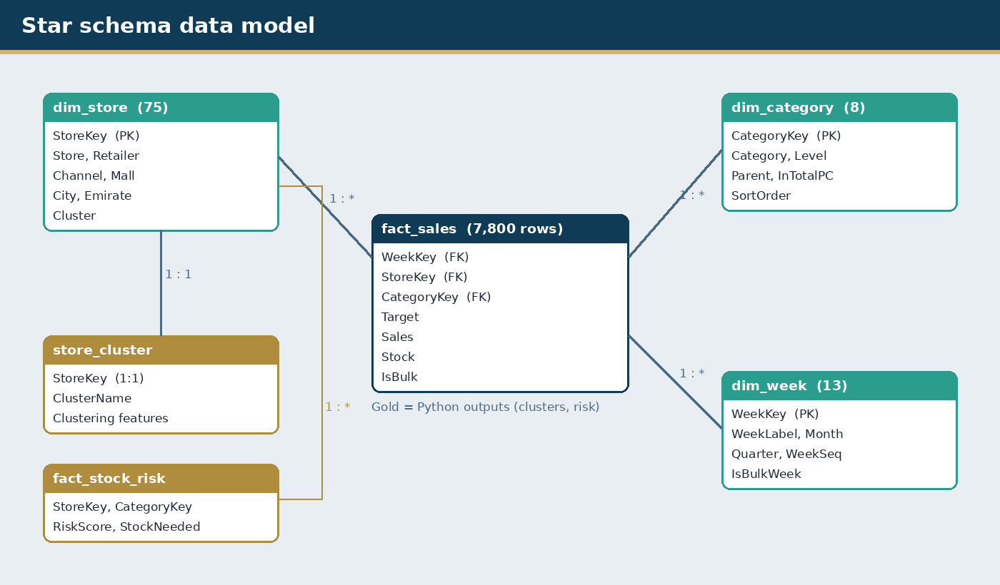

# UAE Retail PC Sell-Out Analytics

End-to-end analytics project on one quarter of weekly PC sell-out data from electronics retailers in the UAE: a messy Excel report turned into a clean star-schema model, a dynamic Power BI dashboard, store clustering and a short-range forecast with stock-ageing risk.

**Tools:** Python (pandas, scikit-learn) · Power BI · DAX · Power Query


## Business question

Which stores, malls and categories are hitting their targets, where is stock piling up, and what should the business do next quarter?

## What I built

| Step | Output |
| --- | --- |
| Data cleaning | Python pipeline that unpivots a wide weekly Excel report (subtotals, merged cells, stacked weeks) into 7,800 tidy rows, reconciled to the report totals |
| Data model | Star schema: one fact table at store × week × category grain with store, category and week dimensions |
| Measures | 20+ DAX measures, including semi-additive closing stock, weeks of stock, week-on-week change and dynamic ranking |
| Dashboard | Two-page Power BI report with a one-click "View by" switch (retailer, mall, emirate, store, category, channel, cluster) built with field parameters |
| Clustering | K-means segmentation of 54 physical stores into four action groups |
| Forecast and risk | Forecast method chosen on held-out weeks (MAPE), plus a rule-based stock-ageing risk score and stock-need estimate |



## Key findings

- Total PC sales reached **94% of target** for the quarter.
- Excluding a one-off bulk order, monthly achievement **declined from 92% to 80% to about 73%**.
- **Accessories reached only 41% of target**, the largest gap of any category.
- **Fast Mover** stores sell the most while holding **under 4 weeks of stock**: a stock-out risk.
- Stores need about **1,500 units** for four weeks of cover, while about **13,100 units** sit beyond four weeks elsewhere: a **distribution problem, not a supply problem**.
- Next-quarter forecast: about **1,450 units a week** (±33%, 4-week average was the most accurate method on held-out weeks).

## Store clusters

| Cluster | Stores | Profile | Action |
| --- | --- | --- | --- |
| Fast Movers | 19 | Highest sales, low stock, growing | Send more stock |
| Core Steady | 27 | Average on every measure | Push to target |
| Low-Volume Premium | 5 | Small, premium-heavy mix, high stock | Review range and promoters |
| Declining & Overstocked | 3 | Falling sales, high stock | Promote or transfer stock |

## Repository contents

```
python/    cleaning, star schema, clustering, forecast and risk scripts
dax/       all DAX measures with notes
powerbi/   custom theme and header background
docs/      data model, data dictionary and project steps
images/    dashboard screenshots and data model diagram
```

## Data note

The source data is confidential and is **not included** in this repository. Retailer and store names are anonymised in the code and hidden in the screenshots. The scripts expect the source report and generated CSVs in a local `data/` folder.
