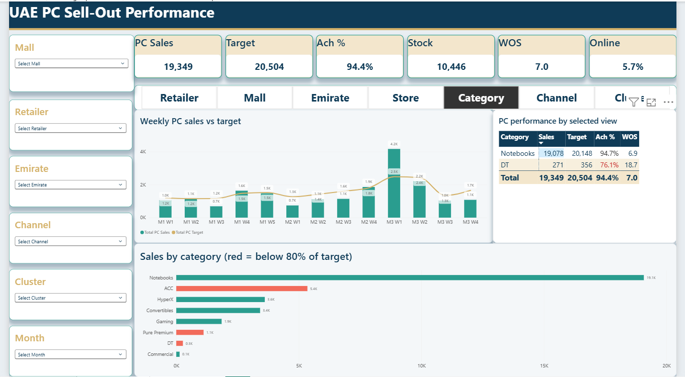
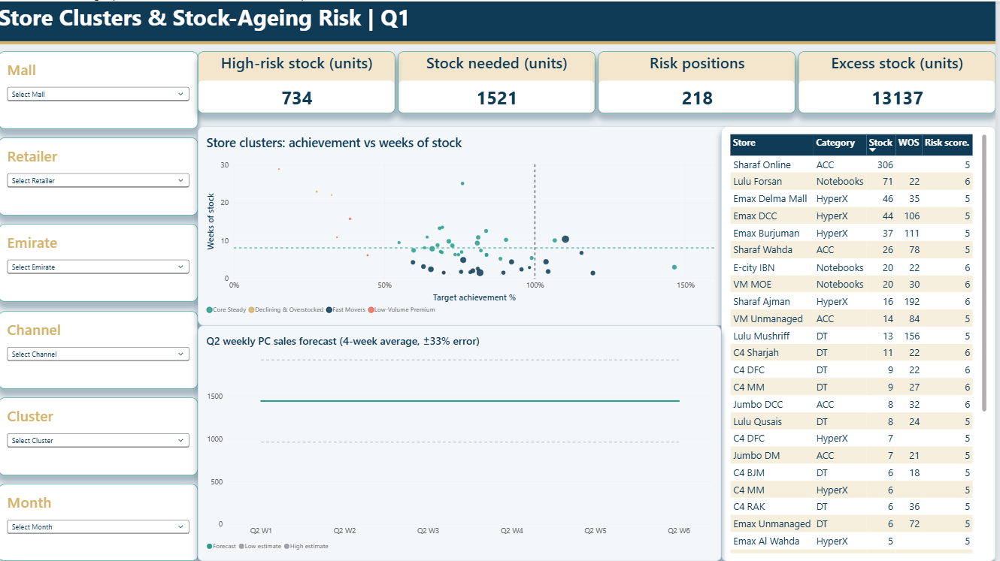
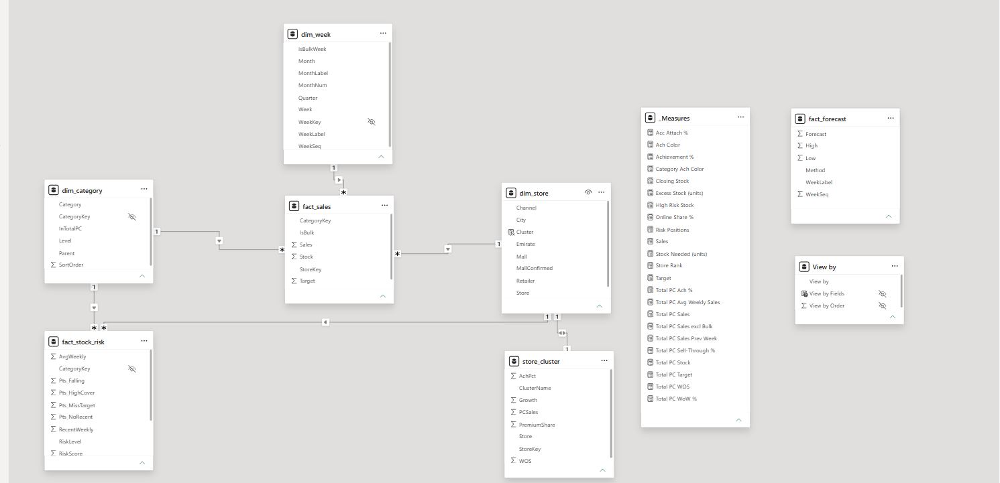

# UAE Retail PC Sell-Out Analytics

End-to-end analytics project on one quarter (13 weeks) of PC sell-out data from electronics retailers in the UAE. A messy weekly Excel report is turned into a clean star-schema model, a dynamic two-page Power BI dashboard, a store segmentation with k-means, and a short-range sales forecast with a stock-ageing risk score.

**Tools:** Python (pandas, scikit-learn) · Power BI · DAX · Power Query

---

## Dashboard Overview – Page 1



KPI cards (sales, target, achievement, stock, weeks of stock, online share), a one-click **View by** switch (retailer, mall, emirate, store, category, channel, cluster), the weekly sales vs target trend and sales by category (coral = below 80% of target).

## Store Clusters & Forecasting – Page 2



Store clusters plotted by target achievement vs weeks of stock, the Q2 sales forecast with its error band, and the store × category positions with the highest stock-ageing risk. *Store names are hidden for confidentiality.*

## Power BI Data Model



Star schema at **store × week × category** grain: `fact_sales` in the centre, linked one-to-many to `dim_store`, `dim_category` and `dim_week`. The Python outputs (`store_cluster`, `fact_stock_risk`, `fact_forecast`) are loaded as separate tables.

---

## Business Question

Which stores, malls and categories are hitting their targets, where is stock piling up, and what should the business do next quarter?

## What I Built

| Step | Output |
|---|---|
| Data cleaning | Python pipeline that unpivots a wide weekly Excel report (subtotals, merged cells, stacked weeks) into 7,800 tidy rows, reconciled to the report totals |
| Data model | Star schema: one fact table at store × week × category grain with store, category and week dimensions |
| Measures | 20+ DAX measures, including semi-additive closing stock, weeks of stock, week-on-week change and dynamic ranking |
| Dashboard | Two-page Power BI report with a one-click "View by" switch built with field parameters, synced slicers and a custom theme |
| Clustering | K-means segmentation of 54 physical stores into four action groups |
| Forecast and risk | Forecast method chosen on held-out weeks (MAPE), plus a rule-based stock-ageing risk score and stock-need estimate |

## Key Findings

- Total PC sales reached **94% of target** for the quarter.
- Excluding a one-off bulk order, monthly achievement **declined from 92% to 80% to about 73%**.
- **Accessories reached only 41% of target**, the largest gap of any category.
- **Fast Mover** stores sell the most while holding **under 4 weeks of stock**: a stock-out risk.
- Stores need about **1,500 units** for four weeks of cover, while about **13,100 units** sit beyond four weeks elsewhere: a **distribution problem, not a supply problem**.
- Next-quarter forecast: about **1,450 units a week** (±33%; a 4-week average beat naive and Holt smoothing on held-out weeks).

## Store Clusters

| Cluster | Stores | Profile | Action |
|---|---:|---|---|
| Fast Movers | 19 | Highest sales, low stock, growing | Send more stock |
| Core Steady | 27 | Average on every measure | Push to target |
| Low-Volume Premium | 5 | Small, premium-heavy mix, high stock | Review range and promoters |
| Declining & Overstocked | 3 | Falling sales, high stock | Promote or transfer stock |

## Recommendations

1. **Rebalance stock** from overstocked stores to Fast Movers before ordering more.
2. **Accessories push**: attach-rate targets and bundles, since accessories are the biggest gap to target.
3. **Clear high-risk stock** (high weeks of stock and no recent sales) with promotions or transfers.
4. **Plan on the real run-rate**: underlying achievement fell each month, so next quarter's plan should exclude the one-off bulk deal.

## How It Was Built

| Step | File |
|---|---|
| 1. Clean and unpivot the weekly report | `python/01_clean_and_unpivot.py` |
| 2. Store lookup (retailer, channel, mall, emirate) | `python/02_store_lookup.py` |
| 3. Star schema with integer keys | `python/03_star_schema.py` |
| 4. Store clusters (k-means) | `python/04_store_clusters.py` |
| 5. Forecast and stock-ageing risk | `python/05_forecast_and_risk.py` |
| 6. DAX measures | `dax/measures.md` |
| 7. Dashboard theme | `powerbi/theme_teal_gold.json` |

More detail: [Data model](docs/data_model.md) · [Project steps](docs/project_steps.md)

## Skills Demonstrated

Data cleaning and reshaping · data modelling (star schema, grain, semi-additive measures) · DAX (CALCULATE, filter context, time logic, ranking) · Power BI design (field parameters, conditional formatting, themes) · unsupervised learning (k-means, scaling, choosing k) · forecasting and evaluation (train/test split, MAPE) · turning analysis into business recommendations.

## Repository Contents

```text
python/    cleaning, star schema, clustering, forecast and risk scripts
dax/       all DAX measures with notes
powerbi/   custom theme and header background
docs/      data model, data dictionary and project steps
images/    dashboard screenshots and data model
```

## Data Note

The source data is confidential and is **not included** in this repository. Retailer and store names are anonymised in the code and hidden in the screenshots. To run the scripts, place the source report in a local `data/` folder.
